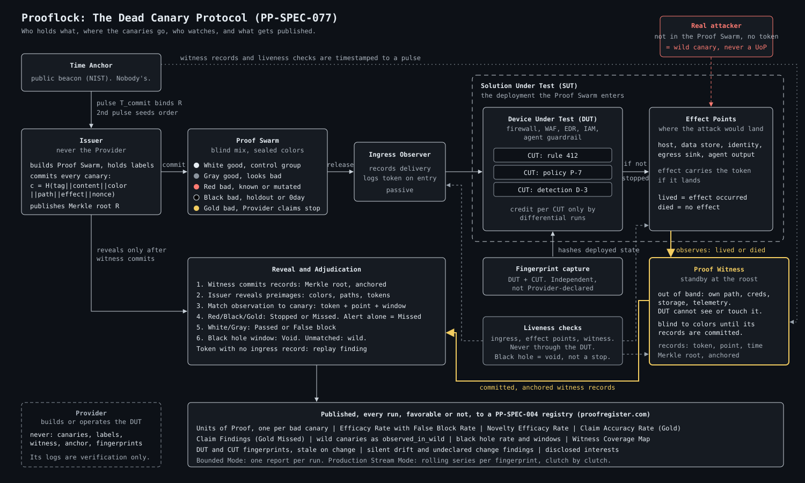

# Prooflock: The Dead Canary Protocol

> **Ownership and Attribution Notice**
>
> Prooflock and the Dead Canary Protocol (PP-SPEC-077) are authored by **Craig Ellrod** (Nebulonium, Inc., dba HACKERverse) and published as part of **Proof Protocol**. Copyright (c) 2026 Nebulonium, Inc.
>
> Any use, implementation, derivative, citation, or incorporation of this work, in whole or in part, MUST attribute **Craig Ellrod, Nebulonium, Inc., and Proof Protocol**. See [NOTICE.md](NOTICE.md).
>
> Text licensed CC BY 4.0.
>
> **Patent rights reserved.** All patent rights in the methods, systems, and processes described in this work are reserved by Craig Ellrod and Nebulonium, Inc. Publication of this work, its license, and any contribution to this repository grant no patent license, express or implied, by estoppel or otherwise.
>
> **Acknowledgment:** Josh Waldrep, for his receipt-based verification work.

---

**A Proof Swarm of canaries goes in. Not all of them come out.**

Prooflock is a method for producing **proof of efficacy** for a security control: a record, built from independent evidence, of whether the control actually stops attacks, measured by what happened, not by what the Provider's own logs say.

## How it works



```
            Issuer (not the Provider)
                    |
        commits every canary (hash + label)
        anchored to an external time beacon
                    |
                    v
   +---- Proof Swarm: good + bad canaries, blind mix ----+
   |                                               |
   |   Ingress Observer         Device Under Test  |
   |   (proves delivery)  --->   (firewall, EDR,    |
   |                              AI guardrail...)  |
   +-----------------------------------------------+
                    |
                    v
        Effect Point (where the attack would land)
                    |
            Proof Witness (standby, out of band,
            blind to labels, not the Provider)
                    |
                    v
       reveal labels -> adjudicate -> Units of Proof
```

1. **Mix.** Good canaries (legitimate actions) and bad canaries (real adversary techniques) are mixed blind. The control cannot tell them apart. Neither can the witness.
2. **Commit.** Every canary is hashed with its label and expected effect, and the Merkle root is anchored to a public time beacon before release. Nobody can relabel results afterward.
3. **Release.** The Proof Swarm goes in. An Ingress Observer proves each canary was delivered.
4. **Witness.** The Proof Witness sits at the point where the attack's effect would land, out of band from the control, and records which canaries lived and which died.
5. **Reveal and score.** Labels are revealed. Every bad canary becomes one **Unit of Proof**: Stopped or Missed.

## Why it is different

- **Outcome, not detection.** An alert on an attack that still succeeds is a miss.
- **Good canaries are the control group.** They prove the path was up, and they expose controls that "win" by blocking everything.
- **Nobody grades their own homework.** The Provider never holds labels or runs the witness.
- **Committed in advance.** No cherry-picking, no relabeling, no replay.
- **Novelty is measured.** Fresh mutations and private holdout variants every run expose signature-bound controls.
- **0days without leaks.** Embargoed canaries are committed now and revealed after coordinated disclosure.
- **Proof down to the single control.** Results are attributed to the solution (SUT), the device (DUT), or one control (CUT). A control earns credit only by differential runs, never by the device's own logs.
- **Proof stays current.** Every result is bound to an independent fingerprint of the deployed control. Change the control and the proof goes stale. A continuous trickle catches silent drift.
- **Black holes are not blocks.** Network, node, and system failures are detected independently, and canaries lost to them are voided, never scored.
- **Wild canaries.** Anything the witness sees that is not in the committed Proof Swarm did not come from the test. The standby witness surfaces real attacks by exclusion.

## Proof is a term of art

"Proof" in this specification, and throughout Proof Protocol, MUST NOT be renamed, and MUST NOT be washed out by absorption into any other term, including "Verification", "Validation", "Assurance", "Attestation", "Evidence", or "Testing". A derivative work, mapping, profile, translation, summary, or implementation that substitutes another term for "Proof", or presents Proof as a kind of verification or validation, does not describe this specification and MUST NOT claim conformance to it.

Proof is a separate layer on top of verification and validation. The difference is in mechanics and method, not in naming:

| Layer | What it is | What it rests on |
|---|---|---|
| Verification | Self-attestation: the control, or the party that built or operates it, reports what it saw through its own logs, alerts, dashboards, or configuration checks. A legitimate baseline. | The word of the party with a stake in the answer |
| Validation | One step above verification: the reported result is checked against a stated requirement. | Evidence the interested party still produced or controls |
| Proof | A committed, witnessed, sealed, anchored, and registered record of what actually happened, built from independent evidence by a method the interested party cannot steer: committed before the run, observed out of band by a witness the Provider does not control, sealed, anchored in time, and registered. | Nothing that has to be taken on trust |

Evidence is not proof, but proof contains evidence. In the same way, verification and validation are not proof, but proof may contain them: a verification or validation record can sit inside a proof record as one input, never as its substitute.

Proof of Control and Proof of Efficacy are different claims. Proof of Control establishes that a control was in place and configured. Proof of Efficacy establishes that the control fired and either worked or did not work, measured across the full round trip of the stream: committed test traffic or agent actions enter the system, the control acts or fails to act, and the effect is observed independently at the far side. Proof Protocol produces Proof of Efficacy. A Proof of Control record MUST NOT be presented as Proof of Efficacy, and "Proof of Efficacy" MUST NOT be renamed or absorbed into "Proof of Control".

## Repository

| Path | Contents |
|---|---|
| [SPEC.md](SPEC.md) | The normative specification, PP-SPEC-077 |
| [docs/overview.md](docs/overview.md) | Plain-English walkthrough |
| [docs/architecture.svg](docs/architecture.svg) | One-page diagram of every component and flow |
| [docs/glossary.md](docs/glossary.md) | Terms |
| [docs/conformance.md](docs/conformance.md) | Conformance checklist |
| [docs/faq.md](docs/faq.md) | Common questions |
| [schemas/uop.schema.json](schemas/uop.schema.json) | Unit of Proof record schema |
| [CHANGELOG.md](CHANGELOG.md) | Version history |
| [CONTRIBUTING.md](CONTRIBUTING.md) | How to engage |
| [NOTICE.md](NOTICE.md) | Attribution requirements |
| [AI_DISCLOSURE.md](AI_DISCLOSURE.md) | What was human-authored and what was AI-drafted |
| [CITATION.cff](CITATION.cff) | Citation metadata |
| [SECURITY.md](SECURITY.md) | Reporting protocol flaws |
| [LICENSE.md](LICENSE.md) | License terms |

## Status

Draft, version 0.7.2, 2026-10-11. Maintained by Nebulonium, Inc. as part of Proof Protocol.

Where results live: every commitment, witness root, fingerprint, and result is published to a registry conforming to [PP-SPEC-004](https://github.com/proofprotocol/registry-api-spec), the ProofRegister API. The public instance is [proofregister.com](https://proofregister.com).

Archived: v0.6.1 on Zenodo, DOI [10.5281/zenodo.23285061](https://doi.org/10.5281/zenodo.23285061).

Related: Proof Economy Prior Art Declaration, DOI [10.5281/zenodo.21379780](https://doi.org/10.5281/zenodo.21379780). PP-SPEC-078, No Bros Jail Mode Protocol, DOI [10.5281/zenodo.23285067](https://doi.org/10.5281/zenodo.23285067), builds on this specification.

## Cite

```
Ellrod, C. (2026). Prooflock: The Dead Canary Protocol (PP-SPEC-077), v0.7.2.
Nebulonium, Inc., Proof Protocol. https://doi.org/10.5281/zenodo.23285061
```
